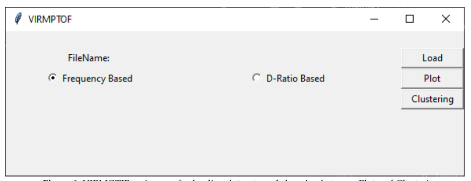
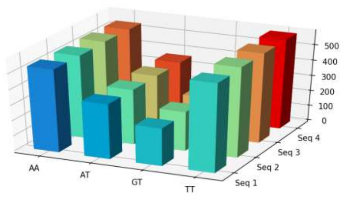
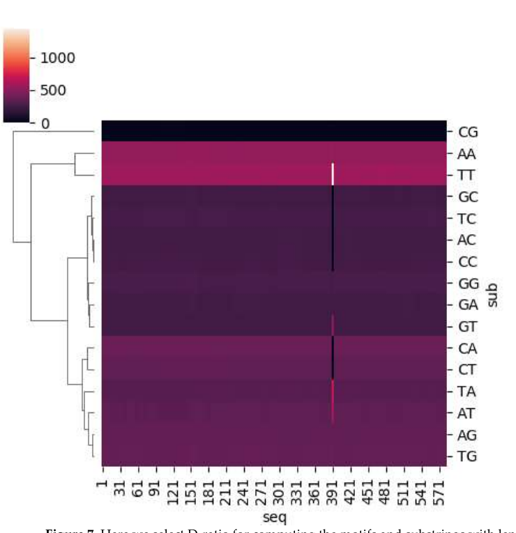

# VIRMOTIF

**A user-friendly desktop tool for viral sequence analysis: k-mer motif counting, Markov-based motif scoring, clustering and visualization, with no coding required.**

[](https://doi.org/10.3390/genes12020186)




Comparing viral genomes often starts with their short-motif composition: which k-mers are over- or under-represented, and which sequences group together. VIRMOTIF does this in one desktop app. Load a FASTA file, choose the motifs you care about, and plot or cluster the sequences.

## Features

- **Motif counting:** counts every substring of length 1–5 (4 to 1,024 motifs) in each sequence and exports raw and normalized tables (`result.csv`, `results_normalize.csv`).
- **Two scoring modes:**
  - *Frequency based:* raw motif counts.
  - *D-ratio based:* compares a motif's frequency with the frequency expected from its shorter sub-motifs (a Markov-chain estimate), to find over- and under-represented motifs.
- **Visualization:** 3D bar charts and heatmaps of selected motifs across selected sequences.
- **Clustering:** k-means, mean shift (estimates the number of clusters), PCA, and hierarchical cluster maps.

| Motif counts across sequences | Hierarchical cluster map (all 2-mers) |
|---|---|
|  |  |

More examples are in [Figures.pdf](Figures.pdf).

## Installation

```bash
git clone https://github.com/Pedram-Rajaei/VIRMOTIF.git
cd VIRMOTIF
pip install -r requirements.txt
```

The GUI uses Tkinter, which ships with Python on Windows and macOS. On Linux, install it with `sudo apt install python3-tk`.

## Usage

```bash
python main.py
```

1. Click **Load** and pick a FASTA file. `JCpolyomavirus.fasta.sample` is a JC polyomavirus genome you can try.
2. Choose **Frequency Based** or **D-Ratio Based**.
3. **Plot:** enter sequence numbers (e.g. `1, 2, 3`) and motifs (e.g. `AA, AT, GT`), or a motif length, then pick a bar chart or heatmap.
4. **Clustering:** enter motifs or a motif length and the number of clusters/components, then run K-means, PCA, MeanShift or ClusterMap.

## Citation

```bibtex
@article{rajaei2021virmotif,
  title   = {{VIRMOTIF}: A User-Friendly Tool for Viral Sequence Analysis},
  author  = {Rajaei, Pedram and Jahanian, Khadijeh Hoda and Beheshti, Amin and Band, Shahab S. and Dehzangi, Abdollah and Alinejad-Rokny, Hamid},
  journal = {Genes},
  volume  = {12},
  number  = {2},
  pages   = {186},
  year    = {2021},
  doi     = {10.3390/genes12020186}
}
```

The version cited in the paper is hosted at [gitlab.com/pedram56rajaii/virmotif](https://gitlab.com/pedram56rajaii/virmotif). This GitHub repository keeps its full history, plus small fixes for current Python and library versions.

## Contact

Pedram Rajaei · prajaei@cougarnet.uh.edu
